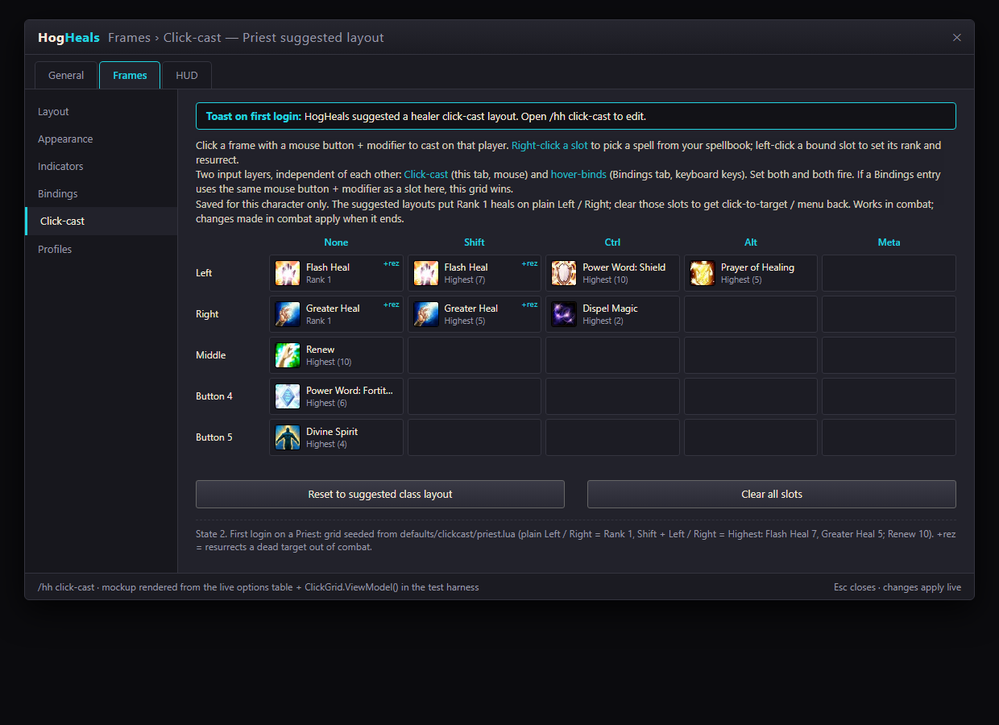

# HogTron UI

HogTron's UI suite for **World of Warcraft: Forever** (Classic+), Anniversary (TBC) and Classic Era: healer frames (HogHeals), HUD, meter, quests & map, nameplates, chat, unit frames and a skin for Blizzard's bars, bags and tooltips.
Opinionated, small, mouseover-first. Not another ElvUI — the one good thing from each, nothing else.

> Naming: **HogTron UI** is the umbrella; **HogHeals** is the healer-frames module it grew out of. Addon folders keep the `HogHeals_*` names for good: saved variables and every module namespace key off them, and a rename would reset every player's settings. Players see "HogTron UI" in the addon list and on CurseForge.

**Status:** public beta (0.1.0-beta.1). Built and unit-tested; in-game testing is what the beta is for - see [docs/TESTERS.txt](docs/TESTERS.txt).

## Install (testers)

1. Download `HogTronUI-<version>.zip` from [Releases](../../releases).
2. Unzip and drop **every** `HogHeals*` folder into `World of Warcraft\_classic_beta_\Interface\AddOns\` (or `_classic_era_` / `_classic_`).
3. Full game start, then `/hh`.

Bugs: open an issue with `/hh version`, `/hh errors` output (or, after a `/reload`, your `SavedVariables\HogHeals.lua`: it carries the error log and client probes), a screenshot and one line on what you did.

## Modules

| Addon | What |
|---|---|
| `HogHeals` | Core: profiles, `/hh` options, group-size auto-layout, combat-safe queue, session stats (`/hh session`), `/hh perf` |
| `HogHeals_Frames` | Party + raid frames for healing: hover-bind engine, click-cast grid (`/hh click-cast`), dispel-by-my-class, debuff + buff rows, test mode (`/hh test 5`), setup wizard |
| `HogTron_Units` | Player / target / target-of-target / pet / focus frames |
| `HogTron_HUD` | Cast bar, swing timer, mana bar with five-second rule, info line, cast bar themes by school / profession (`/hh casttheme`) |
| `HogTron_Bars` | Own action bars (Bartender-style), hover-and-press key binding |
| `HogTron_Plates` | Nameplates: flat bar, quest-mob icons, target marks, own cast bar, DoesItDie skull / reapply mark, object glow on ore / herbs / chests / quest objects (`/hh glow`) |
| `HogTron_Quests` | Quest tracker with the GO row (`/hh go`), quest dialog on a parchment page (`/hh dialog`: Space accepts, 1-9 picks, light or dark), minimap pins, square minimap, addon-button drawer |
| `HogTron_Atlas` | Dungeon guide: levels, bosses, loot, dungeon quests, gear upgrades, Where next (`/hh next`) |
| `HogTron_Training` | What the class trainer has for you, before you get there (`/hh train`) |
| `HogTron_Meter` | Damage / healing meter on the game's own numbers |
| `HogTron_Chat` | Chat restyle, URL copy |
| `HogTron_Skin` | Blizzard's bags, menu bar, tooltips and windows in the same look; info bar |

## Install (developers)

```powershell
.\dev\link.ps1 -Client anniversary     # junction both addons into _anniversary_\Interface\AddOns
```

In game: `/reload`, then

```
/hh              options
/hh test 10      preview 10 fake units (also 5 / 20 / 40, "off")
/hh unlock       drag the anchor, then /hh lock
/hh wizard       re-run setup
/hh errors       show caught errors
/hh macro Flash Heal    print a mouseover→focus→target→self macro
```

Package a tester zip: `python dev/package.py --write` -> `dist/HogTronUI-<version>.zip`.

## Tests

Lua 5.1 runs inside Python via `lupa` against a WoW API mock — no client needed for logic.

```bash
pip install -r requirements-dev.txt
python dev/lint.py        # syntax + toc check
python -m pytest tests -q
```

What tests cannot prove: secure-frame behaviour in combat, real header child creation, rendering. Those need
`/console scriptErrors 1` + a real dungeon pull. Release notes say which rows were run.

## Click-cast

`/hh click-cast` opens Frames > Click-cast: a 5x5 grid of mouse buttons (Left, Right, Middle, 4, 5) by modifiers
(None, Shift, Ctrl, Alt, Meta/Cmd). Right-click a slot to pick a spell from your spellbook; left-click a bound slot to
choose **Highest rank** (follows new ranks) or an exact rank, and **Resurrect if dead** (same click rezzes a dead
target out of combat). Saved per character. Priest, Paladin, Druid and Shaman get a suggested layout on first login
(`HogHeals_Frames/defaults/clickcast/`). It runs next to the keyboard hover-binds (Bindings tab): both fire. With
Clique loaded the grid stands down.



All six states: `docs/mockups/binding-ui/` (`python dev/render_binding_ui.py`; rendered from the live options table in
the test harness, not a WoW screenshot).

## Docs

- `docs/superpowers/specs/2026-09-13-hogheals-frames-design.md` — design spec
- `docs/superpowers/research/2026-10-15-healkit-binding-ui.md` — HealKit (All Rights Reserved) as the click-cast UX inspiration; patterns only, no code
- `docs/superpowers/research/2026-09-13-healing-addon-research.md` — what VuhDo/HealBot/Cell/Grid/Clique/Danders each do best
- `docs/superpowers/plans/2026-09-13-hogheals-frames.md` — implementation plan

## Look

`/hh` > General > Look, or `/hh look ...`: **HogTron** style (shipped fonts, flat bars, Blizzard's windows skinned) or **Classic** (Blizzard's font, bars and windows, every feature kept; needs a `/reload`). Font **Inter** (default), **Manrope** or **Barlow Condensed**; soft shadow or outline; text size; one-click **pixel-perfect** UI scale with undo.

## Licence

MIT. Vendored libraries keep their own licences (see `LICENSE`). Fonts: Inter, Manrope and Barlow Condensed under the SIL Open Font License 1.1 - licence texts in `HogHeals/Media/Fonts/`.
